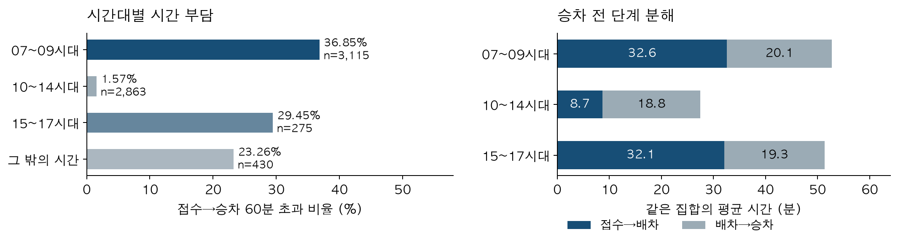
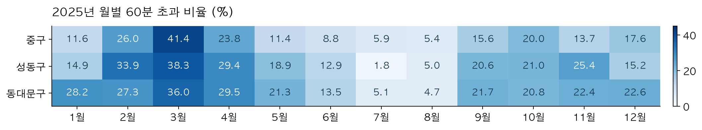
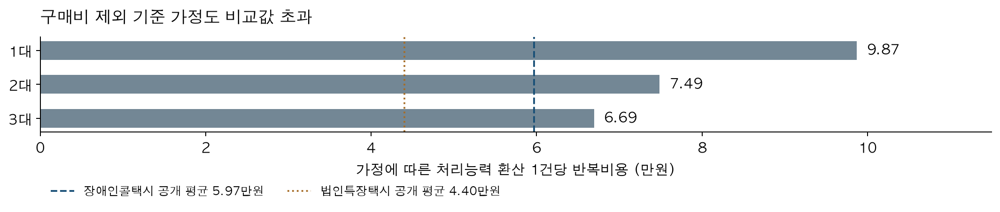

## 1 분석 배경 및 목적

치료·재활을 위한 이동은 목적지까지의 연결뿐 아니라 필요한 시간에 이용할 수 있는지가 중요하다. 서울 중구·성동구·동대문구에서 출발한 치료·재활 이동지원 완료 기록 6,683건을 분석한 결과, 20.56%에서 접수부터 승차까지 60분을 넘겼다. 장시간 기록의 83.55%는 오전 7~9시대에 집중됐다. **필수 목적 이동의 시간 부담을 줄이기 위해 어느 시간대와 운영 단계부터 개선해야 하는가**가 이 연구의 질문이다.

공공 목적은 치료·재활 등 생활 기회에 접근하는 과정의 부담을 낮추는 것이다. 이용량이 많은 지역에 차량을 배치하는 방식에서 나아가, 목적이 확인된 서비스 기록의 시간 부담을 진단하고 배차 개선·기존 자원 연계·예약형 수요응답 운행의 선택 순서를 제시한다.

### 핵심 발견

| 관측한 결과 | 정책 판단에 주는 근거 |
|---|---|
| 치료·재활 완료 6,683건 중 1,374건이 접수→승차 60분 초과 | 선별된 필수 목적 서비스에서도 20.56%의 장시간 기록 관측 |
| 오전 7~9시대 3,115건 중 1,148건이 60분 초과 | 해당 시간대 초과 비율 36.85%이며 전체 장시간 기록의 83.55% 집중 |
| 토·일 오전 7~9시대는 123건 중 3건이 60분 초과(2.44%) | 월~금과 양상이 달라 요일별 운영을 구분해야 함 |
| 1~3대 상당 공급 보강 시나리오의 기준 가정은 비용 비교값 초과 | 차량 구매를 유보하고 기존 자원으로 가능한 개선부터 검증 |

### 통행 규모 탐색에서 실제 서비스 부담 분석으로

세 구는 기존 통신자료 탐색을 이어가는 사례 분석 범위다. 초기 2주 관측을 12주로 늘리고, 기존 2주와 나머지 10주를 분리해 같은 연결이 반복되는지 확인했다. 그러나 고령층 통행의 반복성만으로 교통 이용곤란을 입증할 수 없었다. 이에 실제 이동지원 기록의 필수 목적·승차 전 시간 부담으로 분석 초점을 좁혔다. 같은 선별 조건으로 서울 25개 구 81,988건을 비교하면 60분 초과 비율은 19.91%다. 세 구의 20.56%가 서울 최악을 뜻하지 않으며, 미조정 비율 순서는 동대문구 9위·성동구 11위·중구 18위다. 사례의 요일별 개선 방법을 제안하는 범위로 한정한다.

### 정책적 기여

선행연구[7]는 장애인콜택시의 접근성 격차와 차량 재배치를 분석했다. **본 연구는 치료·재활 목적의 시간 부담을 요일·지역·시간대·배차 전후 단계로 구분하고, 비용 검증까지 연결해 대안의 검증 순서를 제시한다.** 서울시의 기존 첨두 보강 정책에 더해, 필수 목적 이동의 적시 접근과 비대상 이용자 부담을 함께 평가한다. 오전 혼잡의 최초 발견이나 재배치 최적화의 성능 향상을 주장하는 연구는 아니다.

‘이동 곤란’은 이번 자료에서 관측한 서비스 이용 과정의 시간 부담을 뜻한다. 건수는 고유 이용자 수가 아니며, 60분 초과가 진료 지각이나 이동 포기를 직접 의미하지 않는다. 개인의 일반 버스 이용 불가능 여부도 판정하지 않았다.

<!-- pagebreak -->

## 2 활용 데이터

| 활용 데이터 및 제공기관 | 출처 플랫폼·선정 이유·범위 | URL |
|---|---|---|
| 장애인콜택시 탑승내역 / 서울시설공단 | 공공데이터포털. 실제 서비스 시간 부담 분석. 2025년 365일 1,729,476행 | [1] |
| 생활이동 연령별 OD / 서울특별시 | 서울열린데이터광장. 이동 연결의 반복성 탐색. 2026.07.06~09.27, 84일 | [2] |
| 목적 분류 관련 공개 답변 / 서울시설공단 | 공단 홈페이지. 목적 불명과 예정시각 해석 확인. 2026.09.09 | [3] |
| 예산 검토·운영 결과·업무계획 / 서울시·시의회 | 시의회 공식 문서. 비용 기준과 기존 사업의 실행 경로 확인 | [4]~[6] |

URL 번호는 참고문헌의 원문 링크와 대응한다. 통신자료는 84일 OD 282,842,077행에서 고령층 이동 연결의 반복성을 탐색했다. 기존 후보를 고정해 나머지 10주와 비교한 일반 평일 이동량은 구간별 7.17~9.49% 작았다. 두 자료는 시기·모집단이 달라 결합하거나 통신 OD를 DRT 수요로 환산하지 않았다.

## 3 분석과정 및 방법

### 원자료 선별과 지표 정의

접수·예정·배차·승차·하차 시각이 모두 있고, 취소 시각이 없으며 접수≤배차≤승차≤하차인 기록을 정상 완료로 정의했다. 전체 파일에서 1,483,321건이다. 주 분석은 목적에 치료 또는 재활이 포함되고 ‘예약’ 명칭이 없으며 예정−접수 간격이 0~1분인 세 구 기록 6,683건이다. 공식 바로콜 구분이 아닌 관측 조건이다. **전체 1,729,476건 → 정상 완료 1,483,321건 → 세 구 치료·재활 주 분석 6,683건**의 순서로 선별했다.

접수→승차를 접수→배차와 배차→승차로 나눴다. 시간대는 예정시각 기준이며 진료 도착시각이 아니다. P90, 60·90분 초과율, 월별·구별 분포를 계산했다. 60분은 설명 기준이지 법정 기준이 아니다. 별도 CSV·날짜 처리로 시간대별 16개 행의 건수와 초과 건수가 모두 일치함을 확인하고, 요일·차종·시간 조건·상하반기 등 10개 조건을 재집계했다. 월~금은 공휴일을 포함하며, 이는 같은 기간의 안정성 점검이지 신규 자료 예측 검증이 아니다.

공개 OD의 60세 이상을 임의 세분하거나 연령만으로 교통약자를 판정하지 않았다. 목적 ‘기타·예약기타’는 전체 서비스 기록의 80.77%이며, 목적 불명을 비필수로 보지 않았다. 2026년 공개 답변을 2025년 모든 접수 절차와 같다고 가정하지 않았다.

## 4 AI 기술 활용

OpenAI Codex를 자료 분석 코드 작성·검토와 문서화에 활용했다. 주요 프롬프트는 “실제 원자료 분석 실시”, “비용우위 검증해줘”, “버스 정류장이 잘 없는 곳이 어디인지 찾아봐”였다. **실제로 구현한 AI 모델은 접수 정보 기반 장시간 대기 위험 로지스틱 회귀**다. 서울 자료 1~9월 64,925건으로 학습하고 10~12월 17,063건으로 평가했을 때 요일×시간대 기준보다 AUC 0.845→0.868, Brier 0.124→0.116이었다. 그러나 세 구 평가 1,416건에서는 AUC 0.866→0.868, Brier 0.11731→0.11714로 추가 이득이 작았고, 실제 초과 비율 21.20%를 예측 평균 19.08%로 과소 예측했다. 이미 살펴본 연도의 후향적 평가이므로 신규 기간 검증 전 자동배차에 쓰지 않는다.

후속안으로 권역별 단기 수요예측과 시간창·정원·휠체어 설비를 반영한 공동배차 경로 최적화를 제안한다. **이 두 모델은 아직 구현·실증하지 않았다.** 차량 GPS·공차거리·실제 연료량 자료가 없어 대기·연료 절감 효과도 확인되지 않았다. 과거자료 재생, 그림자 운영, 제한 실증으로 검증할 설계와 지표는 분석부록 A14에 제시한다.

<!-- pagebreak -->

## 5 분석 내용 및 결과

### 오전에 집중된 시간 부담

**오전 7~9시대는 주 분석 기록의 46.61%를 차지하지만, 60분 초과 기록의 83.55%가 몰렸다.** 그림 1의 분모는 각 시간대의 정상 완료 기록이며, 단계별 평균은 같은 집합에서 계산했다. 오전 7~9시대 접수→배차는 평균 32.59분, 배차→승차는 20.14분이다. 오전 10시~오후 2시대는 각각 8.65분과 18.79분으로, 두 시간대의 차이는 기록상 배차 전 단계에 주로 나타난다. 따라서 우선 점검할 지점은 오전의 배차 대기 단계다. 근무·차량 위치·예약 운행계획을 확인할 근거이며, 차량 부족이나 특정 배차 방식이 원인임을 확정한 결과는 아니다.

### 연중 반복과 조건 변경 검증

세 구 모두 12개월 내내 장시간 기록이 있었다. 연간 초과 비율은 중구 17.21%, 성동구 20.52%, 동대문구 21.49%다. 월별 수준은 크게 달라 연평균으로 연중 같은 보강을 설계할 수 없다. 예정−접수 5분 허용 시에도 구별 비율은 17.25%·20.49%·21.47%로 비슷했다. 

| 추가 검증 조건과 기록 수 | 오전 7~9시대 / 10~14시대의 60분 초과 비율 |
|---|---|
| 월~금 공휴일 포함 6,337건 | 38.27% / 1.06% |
| 토·일 346건 | 2.44% / 12.80% |
| 특장차만 5,353건 | 35.51% / 1.70% |
| 예정−접수 0~5분 6,745건 | 36.84% / 1.56% |

**토·일은 오전 일괄 보강의 근거가 약해 별도 운영 검토가 필요하다.** 표의 분모는 각 조건·시간대의 기록이며 토·일 오전 123건 중 3건, 10~14시대 125건 중 16건이 초과했다. 요일별 합계는 다른 CSV·날짜 처리 구현의 원자료 재계산으로도 일치했다.

구별 비율만으로 서비스 성과 순위를 확정하지 않는다. 지원 요구·출발 시각·이용자 구성의 차이가 남아 있고, 반복 이용자를 구분하지 못하므로 기록을 독립 개인 표본으로 본 유의성 검정은 하지 않았다. **관측으로 확인한 것은 시간 부담의 반복이며, 진료 지각·이동 포기의 규모나 DRT의 개선 효과는 아니다.**

<!-- pagebreak -->

## 6 정책제안 및 기대효과

### 요일을 구분해 오전 배차 개선과 예약형 운행을 검증한다

**월~금 오전 배차 단계 점검 → 기존 자원으로 운영 개선 → 추가 효과가 필요한 경우 예약형 운행 비교**의 순서로 검증한다. 토·일은 별도 시간대 계획을 평가하고 공휴일 효과도 후속 구분한다. 승하차 지원과 복귀 조건을 동일하게 유지한다. 장애인콜택시에도 전일·정기접수가 있으므로, 예약형 DRT의 검증 대상은 새로운 호출 앱이 아니라 제한된 권역의 사전 운행계획이 만드는 추가 성과다.

| 대안 | 적용 조건과 검증할 효과 |
|---|---|
| 1순위 검증인 기존 운영 개선 | 월~금 오전의 배차 전 간격을 우선 점검. 같은 적합 차량·인력에서 효과 확인. 위험 모형은 사전 점검에 쓰고 토·일은 별도 검토 |
| 보완 대안인 기존 자원 연계 | 법인특장택시 등으로 필요한 지원을 충족하는 요청을 연계. 계약·지원 조건 확인 후 비교 |
| 예약형·권역형 DRT 방식 | 사전 운행계획·제한된 권역이 추가 효과를 낼 때 실증. 합승은 동의·지원·도착 제약을 충족할 경우만 적용 |
| 버스 증회·정기 셔틀·접근환경 개선 | 실제 승차지점 접근이 가능하고 고정 연결이 유효한 이용에 비교 |

### 비용 검증 결과에 따라 차량 선구매를 유보한다

하루 5시간·연 365일, 가동률 70%, 관측 작업시간 42.18분에 추가 준비 10분을 둔 기존 시나리오다. 인력·단가는 확인되지 않은 계획 가정이며 구매비를 뺀 반복비용이다. 그래프의 서울 기준값은 과거 시의회 자료의 평균비용으로, 현재 같은 요청의 추가비용과 같지 않다. 따라서 같은 서비스의 최종 원가 비교는 아니다. 해외 절감률을 서울 예산에 적용하지 않았다.

대수·비용·준비시간·가동률을 달리한 81개 조합 중 공개 콜택시 평균보다 낮은 조합은 16개, 법인특장택시 평균보다 낮은 조합은 3개였다. 두 기준을 통과한 조합은 낮은 비용과 추가 준비시간 0분을 전제했다. 이는 성공 확률이 아니라 가정별 계산 결과다. **기준 가정 1~3대는 두 비교값 모두 초과해 비용 우위를 인정하지 않았다.**

버스 증회·노선 연장도 동일 지원 수준의 실제 추가 견적이 없어 경제성 순위를 정하지 않았다. 일반 버스 평균 운행비와 특수 지원 차량의 단위비용을 직접 맞대지 않는다.

**원자료의 고정 기록에서 월~금 오전 배차 전 간격을 최대 10분 줄인다고 가정하면**, 주 분석의 60분 초과 기록은 1,374건에서 986건으로 388건 줄어든다. 간격은 0분 아래로 줄이지 않았다. 이는 달성 가능성을 입증한 운행 모형이나 정책 실적이 아닌 조건부 민감도다. 따라서 차량 구매보다 기존 운영으로 이 개선을 달성할 수 있는지 먼저 검증하고, 예약형은 추가 성과·비용효과성을 확인한 뒤 선택한다.

<!-- pagebreak -->

### 적용 대상과 실행 및 평가

적용 대상은 세 구에서 출발하는 이동지원 이용 중 필요한 지원과 예약 운행의 적합성을 확인할 수 있는 요청이다. 연령이나 의료 목적 표시만으로 자격·우선권을 일괄 정하지 않는다. 전화와 디지털 접수에 같은 정보를 적용하고 목적 불명·비의료 이동의 성과도 함께 감시한다.

**1단계는 최신 기준선 확인, 2단계는 기존 운영 개선, 3단계는 조건부 예약 실증이다.** 서울시 전체 대기시간은 2024년 40.8분에서 2025년 33.8분으로 감소했다고 보고됐다[6]. 이는 여러 정책이 함께 시행된 전체 평균으로 이번 제안의 효과나 주 분석과 동일한 지표로 간주하지 않는다. 2026년 공급 보강 이후 자료와 가용 자원부터 확인한다. 본 연구의 운행 실증은 아직 수행하지 않았다.

| 평가 영역 | 운영 기록으로 확인할 성과 |
|---|---|
| 필수 이동 접근 | 희망 도착시각과 합의한 승차 범위 준수. 미수용 요청도 함께 보고 |
| 시간 부담·복귀 | 비교 가능한 즉시 요청의 P90·장시간 비율과 복귀 대기 |
| 형평성·지원 | 구·시간대·접수 경로·지원 요구별 격차 및 비대상 이용자 악화 |
| 재정·환경 | 실제 추가 지출, 공차·총 주행거리·에너지 사용과 성과를 함께 평가 |

### 채택과 확대 및 중단 기준

운영기관은 근무표·가용 차량·미배차 기록과 희망 도착시각·지원 요구를 확인하고, 비교 기간·대상·목표를 실증 전에 정한다. 기존 운영 개선으로 목표를 충족하면 이를 채택한다. 예약형은 같은 지원 수준에서 도착 준수·시간 부담의 추가 개선을 확인하고, 비대상 이용자 악화가 없을 때 확대를 검토한다. 지원·안전 조건 위반 시 실증을 중단하며, 효과가 불명확하거나 부담 전가가 반복되면 재설계한다. 차량 구매는 실제 견적과 해당 연도 재원 확인 이후 판단한다.

### 예산과 기대효과의 범위

2026년 제출 예산안의 콜택시 운영은 829.54억원이다. 초기 하루 5시간·매일 운행의 1대 상당 6개월 계획 가정은 반복비 7,250만원·준비비 2,000만원으로 총 9,250만원이다. 요일별 운영을 반영한 견적·확정 예산이 아니다. 운영 범위에 맞춰 재산정하고 기존 사업 중복, 가용 자원과 최신 의결액·집행잔액을 확인해야 한다.

예약형은 전날 접수가 가능하므로 즉시 요청과 접수→승차 전체 시간을 직접 비교하지 않고 합의한 승차·도착 준수로 평가한다. 비슷한 계절·요일·지원 조건의 비교나 단계별 도입으로 효과와 부담 전가를 확인한다.

### 이동권과 환경 성과를 함께 평가한다

주 분석 기록의 양의 승차거리 합계 **42,536.795km**를 환경 평가의 관측 기준선으로 확인했다. 이는 공차·회송을 포함한 총운행거리나 자가용 회피거리가 아니다. 운영 개선 전후 동일한 지원 수준에서 총주행·공차거리와 주유·충전량을 비교하고, 완료 1건당 배출과 전체 배출을 함께 평가한다. 필수 이동 회복에 따른 운행 증가도 포함한다.

감축량은 대체율·합승·공차 가정에 따라 부호가 달라져 본문의 예상 성과로 제시하지 않는다. 약 0.95t 감소 사례는 **설명용 보조 시나리오**로 공개 코드에 남겼다. 108개 가정 조합의 손익분기 계산과 에너지 입력·단위·중복 검사 코드는 검증 도구이며 실제 감축의 증거와 구분한다. 이동권을 보장하면서 불필요한 공차·회송과 에너지 사용을 줄이는지를 후속 실증에서 판단한다.

### 결론

**세 구의 선별된 치료·재활 완료 기록에서 5건 중 약 1건은 접수 후 승차까지 60분을 넘겼고, 장시간 기록은 오전에 집중됐다.** 이 결과에 근거해 요일을 구분한 오전 배차 단계 개선을 먼저 검증하고, 예약형 운행은 추가 성과가 확인될 때 확대한다. 제안의 핵심은 차량 도입 자체가 아니라 필수 목적 이동의 시간 부담을 줄이는 데 예산과 운영의 판단 기준을 맞추는 것이다.

<!-- pagebreak -->

## 분석도구 및 참고문헌

분석: Python 3.13, pandas·NumPy·scikit-learn, CSV·datetime 별도 재계산. 시각화: Matplotlib. AI 지원: OpenAI Codex. 문서: ReportLab·Pandoc. 그림은 본 연구의 저장된 집계 결과를 사용해 생성했다.

[1] 서울시설공단. 장애인콜택시 탑승내역. 공공데이터포털. 2025년 원자료. https://www.data.go.kr/data/15115859/fileData.do

[2] 서울특별시. 서울 생활이동 연령별 OD. 서울열린데이터광장. https://data.seoul.go.kr/dataList/OA-22299/F/1/datasetView.do

[3] 서울시설공단. 이용목적 및 배차시간 관련 공개 답변. 2026.09.09. 목적 불명 분류·목표 도착시각 미관리 등 해석에 사용. https://www.sisul.or.kr/open_content/main/qna/qnaMsgDetail.do?qnaid=QNAS20260908000002

[4] 서울시의회. 2025년도 교통실 예산안 검토보고. PDF 56쪽 각주 68. 2024년 계획에 근거한 건당 운행비용 비교로 현재 원가와 구분. https://ms.smc.seoul.kr/record/appendixDownload.do?key=79b7b2ad9eef23597c28c9c44b07a568fa0b8c34f1ccf463bedb55134235d4cc30a66fa033baa1d3

[5] 서울시의회. 2026년도 교통실 예산안 검토보고. PDF 13쪽. 제출안이며 최종 의결액·현재 잔액 아님. https://ms.smc.seoul.kr/attach/record/SEOUL/appendix/a11/A0070548.pdf

[6] 서울특별시 교통실. 주요업무보고. 2026.02. PDF 8쪽. 2026.03.06 교통위원회 부록. 실제 집행 완료와 구분. https://mas.smc.seoul.kr/record/appendixDownload.do?key=ff5b2e662c3158cc7f21a2bfcdd21488636c21cc43fc4171d8c147c26be6f9ddeb64630b03951932

[7] 임희수·최진무. 2025. 서울시 장애인콜택시의 지역 간 접근성 격차 완화를 위한 차량 재배치 방안. 대한지리학회지 60(6), 772–783. 접근성·재배치 선행연구와 본 연구의 범위를 구분하는 데 사용. https://doi.org/10.22776/kgs.2025.60.6.772

### 코드와 재현 자료

재현 코드 패키지: 망젤이네_재현코드.zip. 원자료는 [1]에서 취득해 안내된 경로에 배치한다. 원자료 선별·집계·비용 검증 코드와 실행 안내를 포함한다. 탄소 가정의 근거표·설명용 시나리오는 보조 자료로 분리하고, CSV 에너지 측정 코드와 검사도 제공한다.

외부 코드 열람 URL: https://github.com/kanginhan1018-gif/AI---

공개 저장소의 README에서 실행 순서와 원자료 취득 방법을 확인할 수 있다. 2026.10.19 비로그인 공개 접근과 최상위 폴더 구성을 확인했다. 보고서 보강본에 맞춰 저장소의 원문·그림·코드를 최신 상태로 유지한다.

공식 공고·양식 확인: https://koreashe.org/notice/?mod=document&uid=95427
